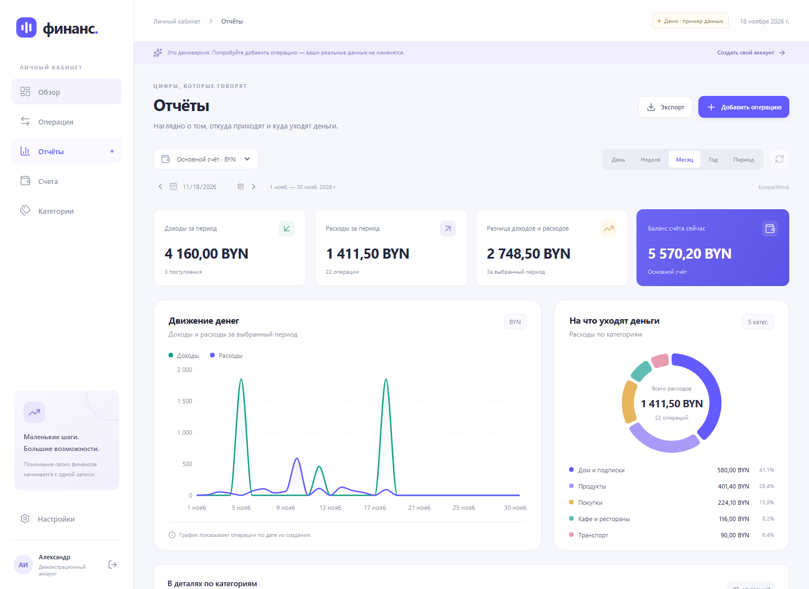
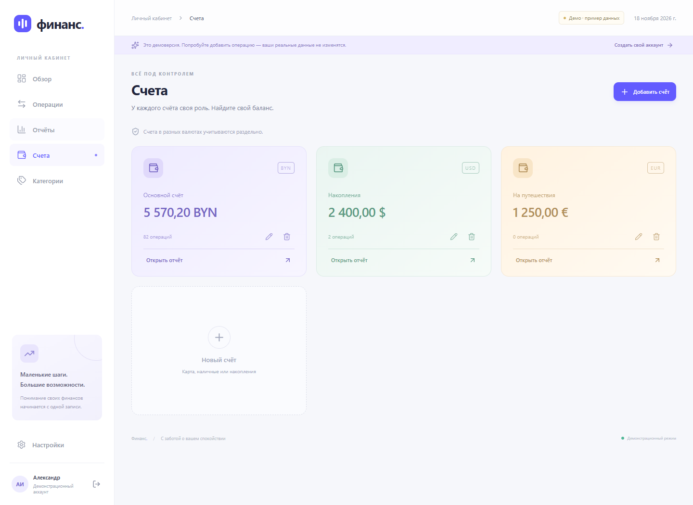
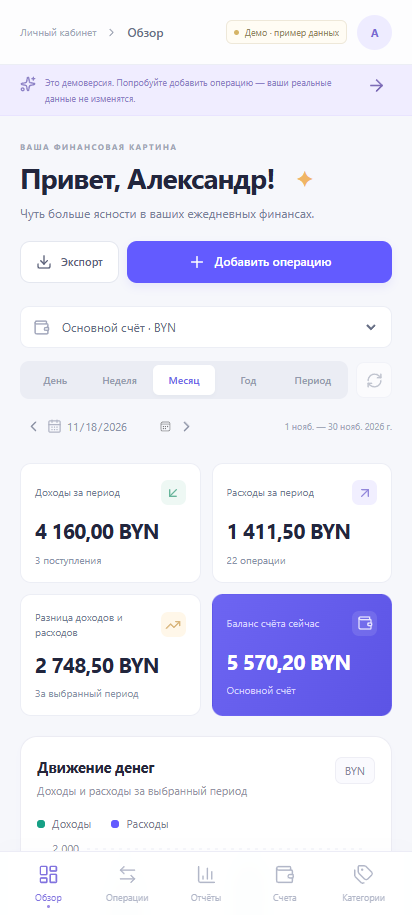
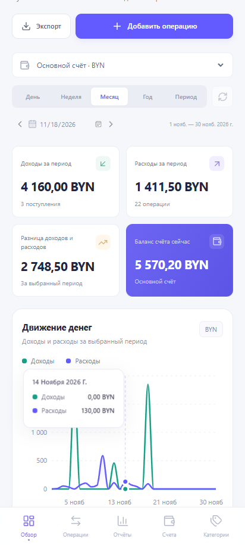
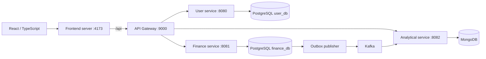

# Финанс · Finance Assistance

**Личные финансы, которые легко понять.**

Full-stack pet-проект для учёта счетов, доходов и расходов. Адаптивный интерфейс
показывает движение денег, расходы по категориям и отчёты за выбранный период.
Java-сервисы хранят финансовые данные в PostgreSQL, а Kafka обновляет
аналитическую проекцию в MongoDB.

**Java 21 · Spring Boot · PostgreSQL · Kafka · MongoDB · React · TypeScript · Recharts**

[Скриншоты](#скриншоты) · [Возможности](#возможности) · [Запуск](#запуск)
· [Архитектура](#архитектура) · [Проверки](#проверки) · [Документация](#документация)

## Скриншоты

Настоящий интерфейс в **деморежиме**: имена, суммы и операции являются примерами.
Деморежим работает в памяти браузера и не изменяет данные в базе.

### Обзор финансов

Доходы, расходы, баланс счёта, динамика операций и структура трат на одном экране.


### Отчёты

Графики доходов и расходов, доли категорий, суммы и средние значения.



<details>
<summary>Посмотреть экран счетов</summary>



</details>

### На телефоне

Мобильная навигация, адаптивные формы и графики. Предусмотрена установка как PWA.

<p>
  
  
</p>

## Возможности

| Раздел | Возможности |
| --- | --- |
| Профиль | Регистрация, вход, обновление профиля и удаление аккаунта |
| Счета | Создание, переименование и удаление; BYN, USD, EUR, RUB |
| Операции | Доходы и расходы, изменение суммы, счёта, категории и комментария |
| Категории | Собственные категории доходов и расходов |
| Отчёты | День, неделя, месяц, год или произвольный диапазон дат |
| Графики | Динамика доходов/расходов и диаграмма расходов по категориям |
| Экспорт | CSV для выбранного счёта с учётом текущих фильтров |
| Мобильный доступ | Адаптивная верстка и PWA-оболочка |

Каждый пользователь работает только со своими данными. Баланс изменяется через
операции; прямое изменение баланса и валюты существующего счёта запрещено.
Версии записей позволяют обнаруживать конкурентные изменения.

## Архитектура



- **Transactional outbox:** операция, изменение баланса и событие сохраняются
  в одной транзакции PostgreSQL. Фоновый publisher доставляет событие в Kafka.
- **Версионная проекция:** аналитика применяет более новые версии операций.
  Повторные и запоздалые события не должны возвращать старое состояние.
- **Асинхронное удаление:** finance и analytics независимо подтверждают очистку
  пользователя; маркеры удаления защищают от поздних событий.
- **Обработка ошибок:** ограниченные повторы и DLT для неисправимых сообщений;
  временные ошибки удаления повторяются до восстановления зависимости.
- **Frontend:** серверный API-прокси, обновление JWT при необходимости,
  токены в `sessionStorage`, отсутствие автоматического повтора денежных
  запросов после неопределённой сетевой ошибки.

Подробные правила блокировок и согласованности: [ARCHITECTURE.md](ARCHITECTURE.md).

## Технологии

| Слой | Стек |
| --- | --- |
| Backend | Java 21, Spring Boot, Spring MVC, Spring Security, JWT, Bean Validation |
| Данные | PostgreSQL, Spring Data JPA, Flyway, MongoDB, Spring Data MongoDB |
| События | Apache Kafka, Spring Kafka, transactional outbox |
| Frontend | React 19, TypeScript, Vite, Recharts, Lucide |
| Инфраструктура | Docker Compose, Prometheus, Grafana |
| Проверки | JUnit, Mockito, интеграционные тесты, Vitest, Playwright |
| Документация API | OpenAPI и Swagger UI через gateway |

## Запуск

### Требования

JDK 21 с настроенным `JAVA_HOME`, Node.js 22.12+ или 24, npm и Docker Desktop
с Linux containers. Готовые скрипты запуска предназначены для Windows/PowerShell.
Maven устанавливается wrapper-скриптом.

### 1. Окружение

```powershell
git clone https://github.com/MegaLolic/finance-tracker.git
cd finance-tracker
Copy-Item .env.example .env
```

Заполни `.env`: `POSTGRES_USER`, `POSTGRES_PASSWORD`, `GRAFANA_ADMIN_USER`,
`GRAFANA_ADMIN_PASSWORD`, `JWT_SECRET`. Секрет HS512 — минимум 64 байта UTF-8.
Используй однострочные значения без кавычек и `export`; случайные hex-строки
подходят для паролей и секретов. `.env` исключён из Git.

### 2. Инфраструктура и backend

```powershell
docker compose up -d
.\user-service\mvnw.cmd -f pom.xml -DskipTests package
.\scripts\services.ps1 start
```

Дождись запуска четырёх Java-сервисов. Flyway применяет миграции при старте.
Логи находятся в `target/local`. В IDEA рабочий каталог — корень проекта
или каталог соответствующего модуля.

### 3. Frontend

```powershell
cd frontend
npm ci
npm run build
npm start
```

Открой **http://localhost:4173**. Зарегистрируйся, добавь счёт и категории,
затем первую операцию. Кнопка **«Посмотреть демо»** показывает заполненный
интерфейс без регистрации и изменения базы.

Для разработки: `npm run dev` → http://localhost:5173.
Для фонового запуска собранного frontend из корня: `./scripts/frontend.ps1 start`.

### Адреса

| Компонент | Адрес |
| --- | --- |
| Приложение | http://localhost:4173 |
| Swagger UI | http://localhost:9000/swagger-ui.html |
| API Gateway | http://localhost:9000 |
| Kafka UI | http://localhost:8070 |
| Prometheus | http://localhost:9090 |
| Grafana | http://localhost:3000 |
| Mongo Express | http://localhost:8088 |

В Swagger выбери User Service, Finance Service или Analytical Service.
Для защищённых запросов используй access JWT из `POST /auth/sign-in`.

### Остановка

```powershell
# Из корня проекта
.\scripts\frontend.ps1 stop
.\scripts\services.ps1 stop
docker compose stop
```

Если frontend запущен через `npm start`, используй `Ctrl+C` в его терминале.
Скрипты останавливают только созданные ими процессы.
**Не выполняй `docker compose down -v`, если нужно сохранить данные.**

## Android и публичная ссылка

В одной Wi-Fi сети приложение доступно по `http://IP-компьютера:4173`, если
брандмауэр разрешает подключение. Для установки PWA на настоящем Android
нужен HTTPS. Мобильная верстка проверена в Android-эмуляции браузера.

Для постоянного адреса локального приложения подготовлен ngrok:
[инструкция](docker/NGROK.md). Токен хранится в исключённом из Git `.env.ngrok`.
Компьютер, Docker и сервисы должны оставаться включёнными.
GitHub хранит код и документацию — загрузка в репозиторий сама по себе
не запускает Java-сервисы и базы. Развёртывание на VPS пока не настроено.

## Проверки

Backend, из корня:

```powershell
.\user-service\mvnw.cmd -f pom.xml test
```

Контекстным тестам нужны `.env` и инфраструктура. Интеграционные тесты включаются
переменными `USER_TEST_DB_*`, `FINANCE_TEST_DB_*`, `ANALYTICS_TEST_MONGO_URI`,
`KAFKA_TEST_BOOTSTRAP_SERVERS`. Используй выделенные тестовые зависимости.
SQL/Mongo сценарии создают временные схемы/базы, Kafka-сценарии — уникальные топики.
Подробности: [проверки backend](docs/OPERATIONS.md#проверки).

Frontend, из `frontend`:

```powershell
npm test
npm run test:e2e
```

Vitest проверяет деньги, календарные границы, часовые пояса и API-клиент.
Playwright проверяет desktop, Android-эмуляцию, реальный API, деморежим и PWA.
На Windows используется установленный Edge; на Linux установи Chromium:
`npx playwright install chromium`. Для E2E нужен работающий backend.
Тестовые пользователи удаляются в завершении сценариев.

В прогоне 18 ноября 2026 прошли **157 backend-тестов без пропусков**,
**38 frontend-тестов** и **6 браузерных сценариев**. Дополнительно проверялись
балансы по независимой модели, конкурентные запросы, восстановление аналитики
после остановки и очистка данных в реальных PostgreSQL/MongoDB.
Это результат конкретного прогона, а не динамический статус CI.

## Текущие ограничения

- Отчёт строится по одному счёту. Конвертации валют и общего мультивалютного баланса нет.
- Дата новой операции задаётся сервером; ввод задним числом пока не поддержан.
- Аналитика обновляется асинхронно, поэтому новая операция может попасть в сводку с задержкой.
- API возвращает историю целиком; большие объёмы потребуют серверной пагинации и оптимизации расчётов.
- PWA не кеширует личные API-ответы; сохранение операций требует подключения к сети.
- Docker Compose рассчитан на локальный запуск. Production требует отдельной настройки
  сети, секретов, HTTPS и резервного копирования.

## Документация

- [Архитектура и гарантии доставки](ARCHITECTURE.md)
- [Подробный запуск, API, мониторинг и обслуживание](docs/OPERATIONS.md)
- [Frontend: разработка, сборка и PWA](frontend/README.md)
- [Постоянный адрес через ngrok](docker/NGROK.md)

```text
api-gateway/          Маршрутизация API и единый Swagger
user-service/         Пользователи, JWT, координация удаления
finance-service/      Счета, категории, операции и outbox
analytical-service/   Kafka-проекция в MongoDB и отчёты
frontend/             React-приложение и сервер API-прокси
docker/               Инфраструктура, мониторинг и документация туннеля
scripts/              Запуск приложений и публичного доступа
docs/                 Скриншоты и эксплуатационная документация
```
